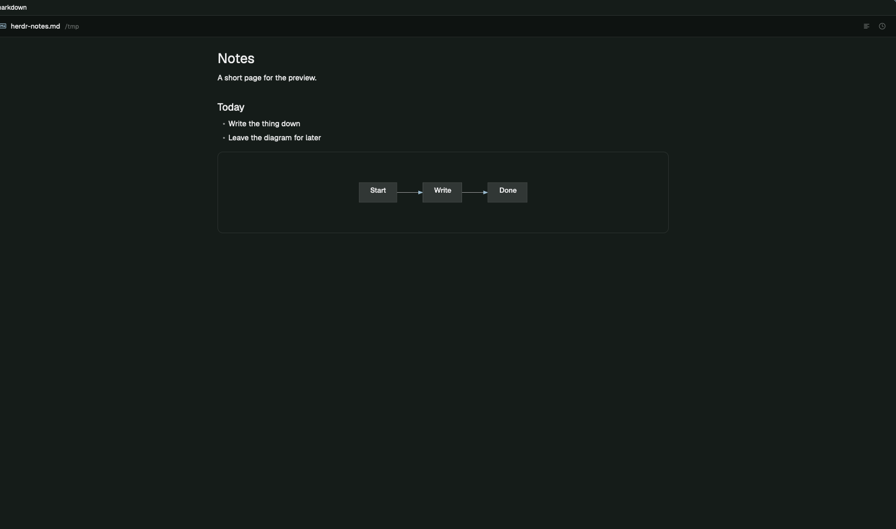

# Markdown

A markdown reader. With no props it lists the markdown files in the focused terminal's project. Clicking one opens that file as its own tab: headings and text in a column, and `mermaid` fences drawn as diagrams. The same mod is both the list and the reader.



## What you see

**List** (no props), a full-height panel, radius 10, `background`, 1px `border`, text 13px:

- Header 42px: "Markdown" semibold, and on the right the repo folder's name (12px, `dim`), truncated, with a tooltip of the full root.
- A filter field under it (30px, radius 8, `border`, placeholder "Filter markdown files…").
- One row per file (28px, radius 7, `hover`; `selected` when that reader tab is the one on screen): `markdown.svg` (14px, `accent` if its tab is open, else `muted`), the file name (truncated, max 200px), and the folder under the repo root (11.5px, `dim`).
- Empty lines: "Finding markdown files…", "No markdown files", "No folder", or the error. Past 2000 files: "Showing the first 2000 files".

**Reader** (`props.file`), `background`, text 14px:

- Header 40px (`chrome`, bottom border): `markdown.svg` (14px, `accent`), the file name (13px semibold), the folder (11.5px, `dim`, home shortened to `~`), then an align button and a reload button (13px icons, `dim`, radius 6, `hover`). The align icon is `align-center.svg` while the page is left aligned, and `align-left.svg` while it is centered. Tooltips: "Center", "Align left", "Reload".
- The page is at most 900px wide, padding 32px horizontal and 24px vertical, 14px between blocks, scrolling vertically. "Center" wraps that column in the middle of the pane. Left aligned is the default.
- Text is rendered as Markdown. A fenced ` ```mermaid ` or ` ~~~mermaid ` block is a diagram on a radius-10 card (`background`, 1px `border`, 16px vertical padding), scaled down to the pane and never wider than the column. While it draws: a 64px row, a spinning spinner, "Drawing diagram…". If it fails, the fence is shown as a code block and a line in `blocked`: "Diagram not drawn: …".
- Before the file is read: "Loading…", "This file is no longer available.", or "Can't read this file."

## How it behaves

- The list follows the focused terminal's folder. A reader tab has no folder of its own, so the list keeps the last terminal's. It refreshes every 10 seconds.
- In a git repo the list is `git ls-files` of `*.md`, `*.markdown` and `*.mdx` from the repo root, including untracked files that are not ignored. Otherwise it is `find` from the folder, skipping `node_modules` and dot folders.
- Clicking a row opens `tab.new` named after the file, mod `markdown`, props `{ file, on }`. Clicking a row whose tab is already open selects that space and tab.
- The align button toggles `shared("markdown.centered")` for every reader. Reload clears drawn diagrams and reads the file again. The reader also reloads when the file's folder changes on this computer (`watchFolder`).
- Scroll position is kept per file. While the tab stays open, the scroll handle keeps the pixel offset. A new copy restores the block index saved as `md-scroll:<file>` in the mod's localStorage.
- Selecting text copies that selection to the clipboard and moves the keyboard onto the reader, so Cmd+C copies the selection instead of going to the terminal. Click a terminal to put the keyboard back.
- Diagram colors come from the theme (`background`, `foreground`, `muted`, `accent`, `raised`, `input`). A diagram is cached under `data/markdown/` by renderer version, source and those colors. Version is `"4"`.

## Built from

- `mods/markdown/`. `mod.json` is `{ "place": "none", "title": "Markdown", "focusable": true }`. `main.js` shows `list.js` with no `file` prop, and `reader.js` with `{ file, on? }`.
- List uses `spaces`, `panes`, `focused`, `exec`, `run`, `theme`. Reader uses `props`, `theme`, `exec`, `readTextFile`, `watchFolder`, `appHome`, `shared`, `setShared`, `settings`, `nextCommand` (the `"focus"` command focuses the reader's handle).
- Diagrams: `node mods/markdown/mermaid/render.mjs`, which uses `beautiful-mermaid` 1.1.3. It resolves CSS variables to plain colors, tints subgraph bodies, inlines arrowheads, and on macOS writes a 2× PNG with `sips`. The reader prefers the PNG when `test -f` finds it.
- Icons in the mod folder: `markdown.svg`, `align-left.svg`, `align-center.svg`. The spinner is the shipped `mods/workspace-chrome/spinner.svg`.
- Runs `git`, `find`, `node`, `mkdir` and `sips` (macOS). Reads the markdown file, and `window` is not used. `on` is the space's machine, so a remote space's files and git run there. Diagrams are drawn on this computer.

## Watch out

- `place` is `none`, so installing it does not dock a panel. Put a block `{ "mod": "markdown" }` where the list should sit. A file tab is `tab.new` with `mod: "markdown"` and `props: { file }`. The Markdown toolbar button and Cmd+M live in a separate tab-bar mod; they are not in this folder.
- Diagrams need Node.js and `npm install` inside `mods/markdown/mermaid`. Do not commit `node_modules`. Without Node, a fence shows "Needs Node.js to draw diagrams."
- The mod reads files outside its folder and runs `git`, `find` and `node`.
- Files over 400000 characters are truncated, with "… file truncated" at the end.
- Nested mermaid subgraphs can place edges in the wrong spot. That comes from the layout library; the renderer does not fix it.
- Don't name a view method `close`. Read `props()` in `init`.

## Done when

- `herdr-app check` on `mods/markdown` passes.
- A layout block of the mod lists the markdown files of the focused terminal's repo, and the filter narrows that list.
- Clicking a file opens a reader tab, and clicking it again selects that tab.
- A ` ```mermaid ` fence draws a diagram after `npm install` in `mods/markdown/mermaid`.
- Selecting a sentence in the reader puts that sentence on the clipboard.
- Center moves the column to the middle, and coming back to the tab returns to the same block.
